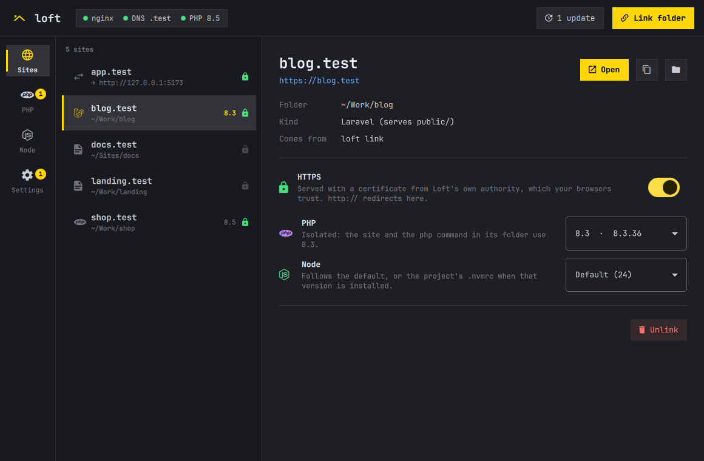

# Loft

Local PHP and Node sites at `name.test`, served by nginx, with HTTPS your
browsers trust and a PHP and Node version per site. A Herd for
[Omarchy](https://omarchy.org): one command in a project folder and it's up.



```sh
cd ~/Work/blog
loft link          # http://blog.test
loft secure        # now https://blog.test, trusted by Chromium, Firefox, curl, PHP and Node
loft isolate 8.3   # this site, and `php` inside its folder, run PHP 8.3
```

## How it works

- **nginx** from Arch runs as your user (a systemd user service). Sites get a
  generated `server` block each; Laravel projects are served from `public/`.
- **DNS**: a tiny DNS server inside `loft` answers `*.test` with this machine.
  A dummy NetworkManager connection routes only `.test` to it through
  systemd-resolved, so every other lookup is untouched.
- **HTTPS**: Loft makes its own certificate authority with `openssl`, trusts it
  in the system bundle and in Chromium's and Firefox's certificate databases,
  and signs a certificate per secured site (`name.test` and `*.name.test`).
- **PHP** 8.2–8.5 are static builds from [static-php.dev](https://static-php.dev)
  (the `bulk` set: intl, opcache, sodium, imagick, redis, PDO for MySQL,
  PostgreSQL and SQLite…), checked against their published SHA-256. Each
  version runs its own PHP-FPM, started only while a site or the default needs it.
- **Node** comes from nodejs.org, checked against `SHASUMS256.txt`.
- **Versions per folder**: `php`, `php8.4`, `composer`, `node`, `npm`, `npx` and
  `corepack` are small shims that pick the version from the folder you're in: a
  site's isolated version, then (for Node) the project's `.nvmrc` or
  `.node-version` when that major is installed, then the default.
- **Updates**: a daily systemd timer checks for new patch releases and sends a
  desktop notification; `loft update` installs them.

The only root steps are done once by `loft setup` through `pkexec`: trusting the
CA system-wide and letting your user bind ports 80 and 443
(`net.ipv4.ip_unprivileged_port_start=80`).

## In the Omarchy bar

`loft setup` puts Loft in the bar's right section. The icon dims when nginx is
stopped; a click opens a panel with:

- **Start / Restart / Stop** for nginx (with DNS and PHP-FPM).
- **Terminal PHP**: one button per installed version, and the folder with the
  default `php` binary.
- **Sites**: click one to open it, the pencil edits its nginx config.
- **All sites / PHP versions** open the window on that page (a right click on
  the icon does the first).

## Your own nginx config

`loft nginx:edit` (or Edit beside a site's nginx config in the window, or the
pencil in the bar) copies the site's generated config to
`~/.config/loft/nginx/<site>.test.conf` and opens it in your editor. Loft serves
that file from then on and reloads nginx every time you save. If it has a
mistake, that one site falls back to Loft's config and a notification says
what's wrong; the rest keep working. HTTPS and PHP changes made in Loft don't
touch your file; `loft nginx:reset` goes back to Loft's.

## Install

```sh
bin/install        # builds the package and installs it with nginx
loft setup         # one-time setup; asks for your password once
loft php:install 8.5
loft node:install 24
```

Open a new terminal afterwards so `php`, `composer` and `node` are Loft's.

## Commands

| Command | What it does |
| --- | --- |
| `loft` | Open the window |
| `loft link [name] [--secure] [--isolate=8.4]` | Serve this folder at `name.test` |
| `loft unlink [name]` | Stop serving a linked folder |
| `loft links` | List every site (`--json` for scripts) |
| `loft park [folder]` / `loft forget [folder]` | Serve every folder inside a folder, as they come and go |
| `loft secure [name]` / `loft unsecure [name]` | HTTPS on or off |
| `loft isolate 8.3` / `loft isolate node@22` | Pin a site to a version (`--site=name` from elsewhere) |
| `loft unisolate [--node]` | Follow the default again |
| `loft proxy app http://127.0.0.1:5173 [--secure]` | Serve `app.test` from a server you run (WebSockets pass) |
| `loft use 8.4` / `loft use node@24` | Set the default version, the terminal's too |
| `loft php:list`, `loft node:list` | Installed and available versions |
| `loft php:install 8.4`, `loft node:install 24` | Install a version |
| `loft php:update`, `loft node:update`, `loft update` | Install newer patch releases |
| `loft php:uninstall 8.3`, `loft node:uninstall 22` | Remove a version |
| `loft php:restart [8.4]` | Restart PHP-FPM after editing `php.ini` |
| `loft which-php`, `loft which-node` | The binary this folder uses |
| `loft check-updates` | Look for new releases now |
| `loft open [name]` | Open a site in the browser |
| `loft nginx:edit [name]` / `loft nginx:reset [name]` | Edit a site's nginx config (reloads on save), or go back to Loft's |
| `loft app [sites\|php\|node\|settings]` | Open the window on a page |
| `loft status` | What's running, PHP versions and sites (`--json` for the bar) |
| `loft doctor` | Check every piece (`--json` for scripts) |
| `loft start`, `loft stop`, `loft restart` | Control nginx, DNS and PHP |
| `loft set check-updates on\|off`, `loft set php-build bulk\|common` | Settings |
| `loft uninstall [--purge]` | Undo setup; `--purge` also deletes runtimes, certificates and settings |

Each PHP version's `php.ini` is yours to edit in `~/.config/loft/php/<version>/`.

## Shortcuts

| Key | Action |
| --- | --- |
| `1` `2` `3` `4` | Sites, PHP, Node, Settings |
| `Tab` / `Shift+Tab` | Move between the list and every control |
| `↑` `↓` / `J` `K` | Select a site |
| `N` | Link a folder |
| `X` | Add a proxy |
| `Space` / `O` | Open the site in the browser |
| `S` | HTTPS on or off |
| `C` | Copy the address |
| `F` | Open the folder |
| `D` | Unlink or remove |
| `R` | Refresh |
| `?` | Show shortcuts |
| `Q` | Quit |

## Files

| Where | What |
| --- | --- |
| `~/.config/loft/config.json` | Sites, parked folders, defaults |
| `~/.config/loft/php/<version>/php.ini` | Your PHP settings |
| `~/.config/loft/nginx/<site>.conf` | Your own nginx config for a site, when you made one |
| `~/.local/share/loft/` | PHP, Node, shims, nginx config, certificates |
| `~/.local/state/loft/logs/` | nginx and PHP-FPM logs |
| `~/.config/systemd/user/loft-*` | The services |
| `/usr/share/loft/omarchy-plugin/` | The bar widget, linked from `~/.config/omarchy/plugins/loft.panel` |

## Development

```sh
bin/build    # build/loft
bin/test     # Qt Test, offscreen, against a temporary home
```

C++17 and Qt Quick, built with qmake. MIT licensed.
